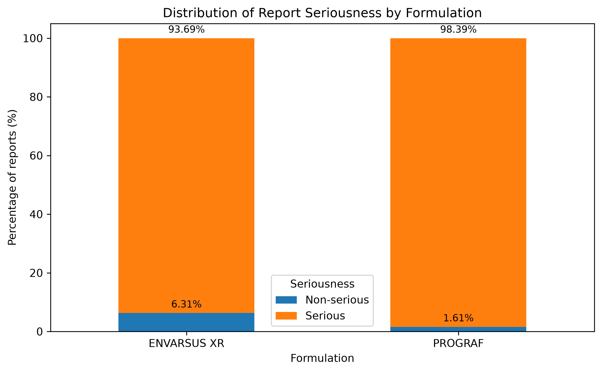
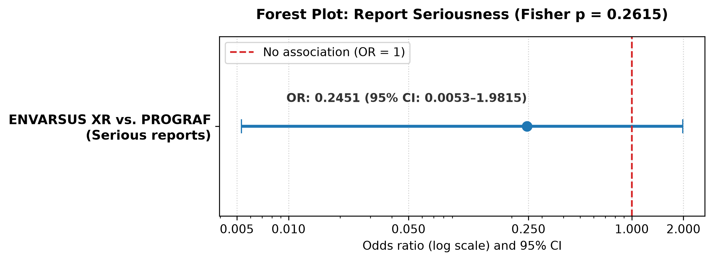

# Prograf vs. Envarsus XR: Comparative Pharmacovigilance Analysis Using FAERS and Python

## Project Overview

This project presents a comparative pharmacovigilance analysis of adverse event reports associated with Prograf and Envarsus XR, two tacrolimus formulations, using data from the FDA Adverse Event Reporting System (FAERS).

The analysis focuses on reports received during 2025 in which either formulation was classified as the Primary Suspect drug and the reported indication explicitly corresponded to renal transplantation.

The primary objective was to evaluate whether the tacrolimus formulation was associated with the seriousness of reported adverse events.

**Key result:** no statistically significant association was found between formulation and report seriousness (Fisher's exact test, p = 0.2615; OR for a serious report, Envarsus XR vs. Prograf = 0.25, exact 95% CI 0.0053–1.9815).

## Background

Tacrolimus is a calcineurin inhibitor used to prevent rejection after kidney transplantation. **Prograf** is an immediate-release formulation taken twice daily, whereas **Envarsus XR** is an extended-release formulation taken once daily, designed to provide a more gradual absorption.

Clinical studies have described practical differences between them. In a retrospective study of stable kidney transplant recipients converted from Prograf to Envarsus, similar trough levels were achieved with a lower daily dose (Franco et al., 2019). In a prospective phase 3b study, kidney transplant recipients with tremor reported improvement after switching from immediate-release tacrolimus to Envarsus XR (Langone et al., 2015).

These studies provide clinical context only. Their designs, populations, and outcomes differ from those of this analysis, which describes spontaneous adverse event reports and does not compare clinical effectiveness or safety.

## Table of Contents

- [Background](#background)
- [Objectives](#objectives)
- [Data Source](#data-source)
- [Data Preparation](#data-preparation)
- [Tools & Technologies](#tools--technologies)
- [Methodology](#methodology)
  - [Cohort Construction](#cohort-construction)
  - [Analytical Approach](#analytical-approach)
- [Results and Discussion](#results-and-discussion)
- [Conclusions](#conclusions)
- [Project Structure](#project-structure)
- [Installation & Reproducibility](#installation--reproducibility)
  - [Requirements](#requirements)
  - [Environment Setup](#environment-setup)
  - [Running the Analysis](#running-the-analysis)
  - [Expected Validation](#expected-validation)
- [Limitations](#limitations)
- [Future Work](#future-work)
- [Skills Demonstrated](#skills-demonstrated)
- [References](#references)
- [License](#license)
- [Acknowledgments](#acknowledgments)

## Objectives

- Retrieve and process FAERS reports associated with Prograf and Envarsus XR during 2025.
- Construct an analytical cohort of reports with an explicit renal transplant indication and either formulation classified as Primary Suspect.
- Compare the distribution of serious and non-serious reports between formulations.
- Describe demographic characteristics, serious outcomes, and reported adverse reaction terms.
- Apply statistical methods to evaluate the association between formulation and report seriousness.
- Document the analytical workflow, methodological decisions, and limitations to support reproducibility.

## Data Source

Data were obtained from the **FDA Adverse Event Reporting System (FAERS)** through the [openFDA Drug Event API](https://open.fda.gov/apis/drug/event/).

The dataset included adverse event reports received between 1 January and 31 December 2025 for Prograf and Envarsus XR. Data were retrieved on **16 November 2026**.

Because FAERS is updated quarterly, the raw API responses are stored in `data/raw/` as JSON snapshots, each including its retrieval date. The notebook loads these snapshots instead of querying the API again, so the results can be reproduced exactly. If a snapshot is missing, the notebook downloads the data and saves a new one.

Queries were made without an API key, which allows 240 requests per minute and 1,000 requests per day per IP address ([openFDA authentication](https://open.fda.gov/apis/authentication/)). Each request returns a limited number of records (`limit`; 999 in this analysis). Both queries returned fewer reports than this limit (692 and 387), so pagination was not required; longer periods would require paginating with the `skip` parameter.

## Data Preparation

FAERS data were retrieved in JSON format using separate queries for Prograf and Envarsus XR. The records were processed with pandas to:

- Combine both queries and keep the latest version of each report (`safetyreportversion`), using `safetyreportid` as the unique report identifier.
- Extract and normalize nested drug, patient, and reaction information.
- Remove duplicated report–reaction combinations.
- Prepare report-level datasets for cohort construction and descriptive and statistical analysis.

## Tools & Technologies

- **Python 3.13** – Programming language.
- **pandas 3.1** – Data manipulation and analysis.
- **NumPy 2.5** – Numerical operations.
- **SciPy 1.18** – Statistical analysis.
- **Matplotlib 3.11** – Data visualization.
- **seaborn 0.13** – Statistical data visualization.
- **Requests 2.34** – API requests.
- **Jupyter Notebook** – Interactive analysis and documentation.
- **Visual Studio Code** – Development environment.

## Methodology

### Cohort Construction

The selection process included:

- Combining both queries and removing duplicate reports, keeping the latest version of each `safetyreportid`.
- Identifying Prograf and Envarsus XR records classified as Primary Suspect (`drugcharacterization = 1`).
- Selecting reports with the explicit drug indication `Renal transplant`.
- Classifying each report according to the suspected formulation.
- Excluding reports that included both formulations (*mixed exposure*).

| Stage | Reports |
|---|---|
| Prograf query (2025) | 692 |
| Envarsus query (2025) | 387 |
| Unique candidate reports (latest version kept) | 1,072 |
| Target formulation as Primary Suspect with *Renal transplant* indication | 174 |
| Excluded: mixed exposure | 1 |
| **Analytical cohort** | **173** (Envarsus XR: 111; Prograf: 62) |

### Analytical Approach

**Descriptive analysis.** Report seriousness, demographic characteristics, serious outcomes, and the ten most frequent MedDRA Preferred Terms (including ties) were described for each formulation. All percentages use the number of unique reports per formulation as the denominator. According to the openFDA documentation, serious outcome fields (`seriousness*`) are recorded only when the criterion applies; a missing field was therefore interpreted as the outcome not having occurred.

**Statistical analysis.** The association between formulation and report seriousness (Serious vs. Non-serious) was evaluated with a two-sided **Fisher's exact test**, because 25% of the cells in the 2 × 2 table had expected frequencies below 5. The association was summarized with the **conditional maximum likelihood odds ratio** and its **exact 95% confidence interval**, inverted to describe the odds of a Serious report. The Phi coefficient is reported for reference only, because its maximum possible value is limited by the unbalanced margins of the table.

The reporting of methods and limitations was informed by guidance on FAERS analyses (Potter et al., 2025) and, as a general reference, the READUS-PV reporting guideline (Fusaroli et al., 2024), which was developed for disproportionality analyses and was therefore used only as inspiration.

## Results and Discussion

A total of 173 FAERS reports from 2025 were analyzed: 111 associated with Envarsus XR and 62 with Prograf. Almost all reports were serious for both formulations: 93.69% for Envarsus XR (104/111) and 98.39% for Prograf (61/62).

| Measure | Value |
|---|---|
| Fisher's exact test (two-sided) | p = 0.2615 |
| Odds ratio (Serious, Envarsus XR vs. Prograf) | 0.25 |
| 95% CI (exact, conditional) | 0.0053–1.9815 |
| Phi coefficient (reference only) | 0.1072 |

No statistically significant evidence of an association between formulation and report seriousness was found. The point estimate suggests lower odds of a serious report for Envarsus XR, but the confidence interval is very wide and includes 1: the data are compatible with much lower odds as well as with nearly twofold higher odds. With only 8 non-serious reports (7 Envarsus XR, 1 Prograf), the analysis has low statistical power, so the absence of a significant difference does not show that the formulations are equivalent.

<p align="center">
  
  
</p>

**Serious outcomes.** Hospitalization was the most frequent serious outcome in Envarsus XR reports (52.25%), whereas "Other medically important events" was the most frequent in Prograf reports (66.13%). The proportion of reports with death was 23.42% for Envarsus XR and 11.29% for Prograf. A report can include more than one outcome, and these comparisons were not tested statistically.

| Outcome | Envarsus XR (n = 111) | Prograf (n = 62) |
|---|---|---|
| Death | 26 (23.42%) | 7 (11.29%) |
| Hospitalization | 58 (52.25%) | 27 (43.55%) |
| Disability | 6 (5.41%) | 3 (4.84%) |
| Life-threatening | 2 (1.80%) | 4 (6.45%) |
| Other medically important events | 41 (36.94%) | 41 (66.13%) |
| Congenital anomaly | 0 (0.00%) | 0 (0.00%) |

**Reported reactions.** The most frequent Preferred Term was *Death* for Envarsus XR (18.02% of reports) and *Neutropenia* for Prograf (9.68%). Several infection-related terms appeared in the top 10 of both formulations. In FAERS, the term *Death* often records the outcome when no cause was specified, so it should not be read as a specific adverse reaction.

**Demographics.** Age and sex distributions were descriptively similar between formulations (mean age 56.56 vs. 53.42 years; female 55.10% vs. 49.12% among reports with known sex). Age was missing in 26.01% of reports and sex in 10.40%.

Because FAERS is a spontaneous reporting system without exposure denominators, the results describe the distribution of the included reports and cannot establish causality or estimate the incidence or risk of adverse events.

## Conclusions

- No statistically significant evidence of an association was found between tacrolimus formulation (Envarsus XR or Prograf) and the seriousness of adverse event reports in FAERS during 2025.
- The proportion of serious reports was high for both formulations (93.69% for Envarsus XR and 98.39% for Prograf). The odds ratio was estimated with substantial uncertainty because of the small number of non-serious reports.
- Demographic characteristics, serious outcomes, and reaction terms provided a descriptive characterization of the included reports. The descriptive differences observed were not tested statistically and should not be interpreted as differences in risk or safety.
- Results should be interpreted considering the limitations of FAERS, particularly spontaneous reporting, the absence of exposure denominators, and the inability to establish causality.
- This analysis provides an exploratory and reproducible characterization of reports for both formulations and may serve as a starting point for further investigation using complementary clinical and pharmacological data.

## Project Structure

```text
faers-prograf-envarsus-2025/
│
├── README.md
├── LICENSE
├── requirements.txt
├── .gitignore
│
├── data/
│   └── raw/
│       ├── prograf_2025_raw.json
│       └── envarsus_2025_raw.json
│
├── notebooks/
│   └── faers_prograf_envarsus_2025.ipynb
│
└── results/
    ├── plots/
    │   ├── 01_seriousness_by_formulation.png
    │   ├── 02_age_by_formulation.png
    │   ├── 03_sex_by_formulation.png
    │   ├── 04_serious_outcomes_by_formulation.png
    │   ├── 05_top_reactions_envarsus.png
    │   ├── 06_top_reactions_prograf.png
    │   └── 07_forest_plot_or_serious.png
    │
    └── tables/
        ├── 01_seriousness_counts.csv
        ├── 02_seriousness_percent.csv
        ├── 03_age_by_formulation.csv
        ├── 04_sex_percent.csv
        ├── 05_serious_outcomes.csv
        ├── 06_top_reactions_envarsus.csv
        ├── 07_top_reactions_prograf.csv
        └── 08_statistical_summary.csv
```

## Installation & Reproducibility

### Requirements

- Python 3.13
- Git
- pip

### Environment Setup

Clone the repository:

```bash
git clone https://github.com/mtzmane/faers-prograf-envarsus-2025.git
cd faers-prograf-envarsus-2025
```

Create and activate a virtual environment (Windows):

```bash
py -3.13 -m venv .venv
.venv\Scripts\activate
```

On macOS or Linux, use `python3 -m venv .venv` and `source .venv/bin/activate`.

Install the dependencies:

```bash
python -m pip install --upgrade pip
pip install -r requirements.txt
```

### Running the Analysis

Launch Jupyter Notebook from the repository root:

```bash
jupyter notebook
```

Open `notebooks/faers_prograf_envarsus_2025.ipynb` and run all cells (**Kernel → Restart & Run All**). The notebook loads the raw snapshots from `data/raw/` and saves the figures and tables to `results/`.

### Expected Validation

The cohort construction should reproduce the following counts:

- Initial Prograf reports: 692.
- Initial Envarsus XR reports: 387.
- Unique reports after combining and deduplicating: 1,072.
- Reports with a target formulation as Primary Suspect and an explicit `Renal transplant` indication: 174.
- Mixed exposure reports excluded: 1.
- Final analytical cohort: 173 reports (111 Envarsus XR and 62 Prograf).

These counts correspond to the included snapshots. Deleting the snapshots and downloading new data may produce different counts, because FAERS records are added and updated over time.

## Limitations

- **Spontaneous reporting:** FAERS is subject to underreporting, reporting bias, and variability in data quality and availability. The analyzed reports do not necessarily represent all adverse events occurring among tacrolimus users.
- **Suspect drug attribution:** the classification of Prograf and Envarsus XR as *Primary Suspect* reflects the attribution recorded in the report and does not confirm causality. The involvement of other medications, underlying diseases, or additional factors cannot be ruled out.
- **Absence of exposure denominators:** FAERS does not provide exposure denominators to calculate incidence, prevalence, or risk. The reported proportions describe only the distribution of reports in the analytical cohort.
- **Small number of non-serious reports:** only 8 reports were non-serious, which limits statistical power and produces a very wide confidence interval for the odds ratio.
- **Clinical data availability:** missing demographic information (age in 26.01% and sex in 10.40% of reports) may affect descriptive comparability between formulations.
- **Selection criteria and study period:** selecting reports with the explicit indication `Renal transplant` restricted the analysis to a specific clinical context, but may have excluded kidney transplant recipients whose indication was recorded with alternative, incomplete, or missing terms. The results correspond to reports received from January to December 2025, and FAERS records may receive later updates.

## Future Work

- Extend the analysis to several years using pagination with the openFDA `skip` parameter.
- Review alternative or incomplete indication terms to capture kidney transplant recipients not coded as `Renal transplant`.
- Explore a properly designed disproportionality analysis (e.g., ROR or PRR) following the READUS-PV reporting guideline.

## Skills Demonstrated

- **API data retrieval and JSON processing:** openFDA queries, nested JSON normalization with `pd.json_normalize` and `explode`.
- **Cohort construction:** explicit inclusion and exclusion criteria, report versioning, and deduplication.
- **Statistics for sparse data:** Fisher's exact test, conditional odds ratio with an exact confidence interval, forest plot.
- **Reproducible workflow:** raw-data snapshots with retrieval dates, reusable functions, and exported tables and figures.
- **Domain knowledge:** pharmacovigilance concepts (Primary Suspect, seriousness criteria, MedDRA Preferred Terms) and transplant immunosuppression.

## References

- Potter, E., Reyes, M., Naples, J., & Dal Pan, G. (2025). FDA Adverse Event Reporting System (FAERS) Essentials: A Guide to Understanding, Applying, and Interpreting Adverse Event Data Reported to FAERS. *Clinical Pharmacology & Therapeutics*, 118(3), 567–582. https://doi.org/10.1002/cpt.3701
- Fusaroli, M., Salvo, F., Begaud, B., et al. (2024). The REporting of A Disproportionality Analysis for DrUg Safety Signal Detection Using Individual Case Safety Reports in PharmacoVigilance (READUS-PV): Explanation and Elaboration. *Drug Safety*, 47(6), 585–599. https://doi.org/10.1007/s40264-024-01423-7
- Franco, A., Más-Serrano, P., Balibrea, N., et al. (2019). Envarsus, a novelty for transplant nephrologists: Observational retrospective study. *Nefrología*, 39(5), 506–512. https://doi.org/10.1016/j.nefro.2018.11.009
- Langone, A., Steinberg, S. M., Gedaly, R., et al. (2015). Switching STudy of Kidney TRansplant PAtients with Tremor to LCP-TacrO (STRATO): An open-label, multicenter, prospective phase 3b study. *Clinical Transplantation*, 29(9), 796–805. https://doi.org/10.1111/ctr.12581
- U.S. Food and Drug Administration. (2026). *openFDA: Drug Adverse Event API (FDA Adverse Event Reporting System [FAERS])* [Data set]. Retrieved November 16, 2026, from https://open.fda.gov/apis/drug/event/searchable-fields/

## License

The code in this repository is released under the [MIT License](LICENSE). FAERS data are provided by the U.S. Food and Drug Administration through openFDA and remain subject to the [openFDA terms of service](https://open.fda.gov/terms/).

## Acknowledgments

The author acknowledges the [U.S. Food and Drug Administration (FDA)](https://www.fda.gov/) for providing public access to adverse event reporting data through the [FAERS database](https://www.fda.gov/drugs/surveillance/fda-adverse-event-reporting-system-faers) and the [openFDA platform](https://open.fda.gov/).
